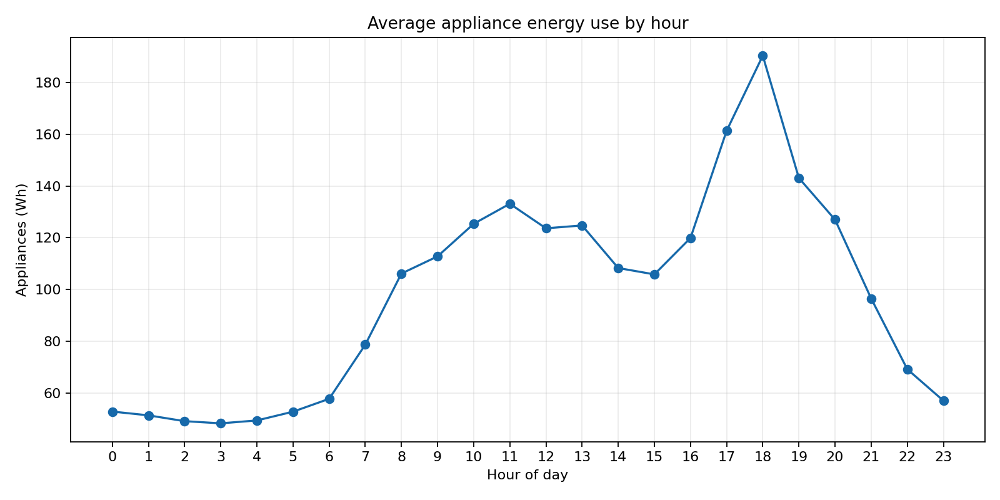
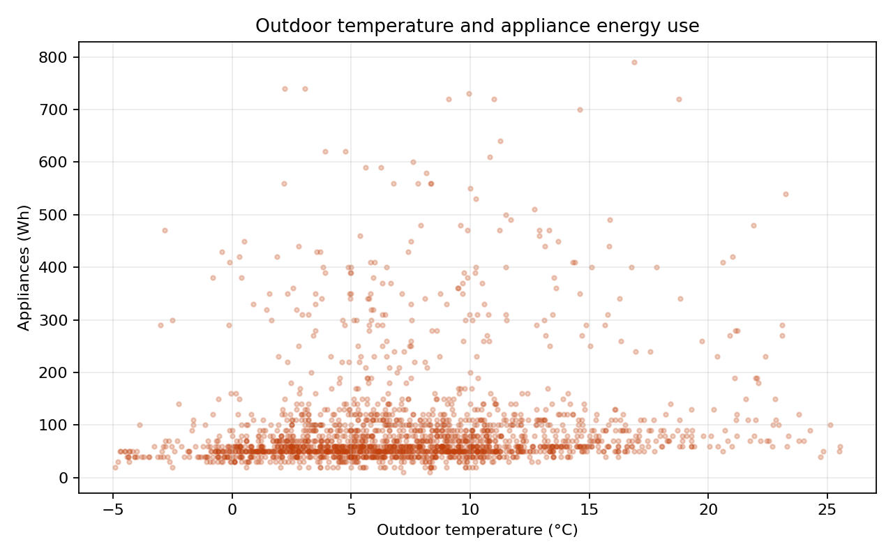

# Energy and Weather Exploratory Analysis

Dataset: UCI Appliances Energy Prediction (ID 374). The observation period runs from 2016-01-11 17:00:00 to 2016-05-27 18:00:00 at ten-minute intervals.

## Quality overview

- 19,735 rows and 28 numeric analysis columns after parsing `date` as the index.
- 0 missing cells and 0 duplicate rows in the downloaded CSV.
- Mean appliance consumption: 97.69 Wh; median: 60.00 Wh; maximum: 1080 Wh.

## Findings

- Mean appliance consumption is lowest around 03:00 (48.2 Wh) and highest around 18:00 (190.4 Wh).
- The Pearson correlation between appliance consumption and outdoor temperature is 0.099; the correlation with lighting use is 0.197.
- Indoor temperature variables are strongly correlated with one another, so they should not be interpreted as independent signals without addressing multicollinearity.

These are observational associations in one Belgian household over roughly four and a half months. They do not establish that weather or any other variable causes appliance consumption, and the random variables `rv1` and `rv2` are retained only as source columns, not interpreted as meaningful drivers.

## Visuals





## Reproduction

```bash
python -m pytest -q
python -c "from src.energy_analysis import load_energy_data, write_analysis_outputs; from src.energy_report import build_report; f=load_energy_data('data/raw/energydata_complete.csv'); write_analysis_outputs(f, 'reports/data'); build_report(f, 'reports')"
```
